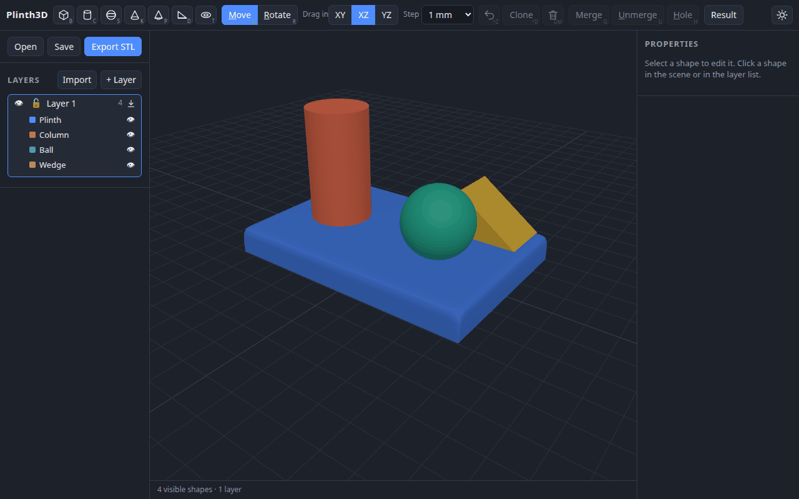
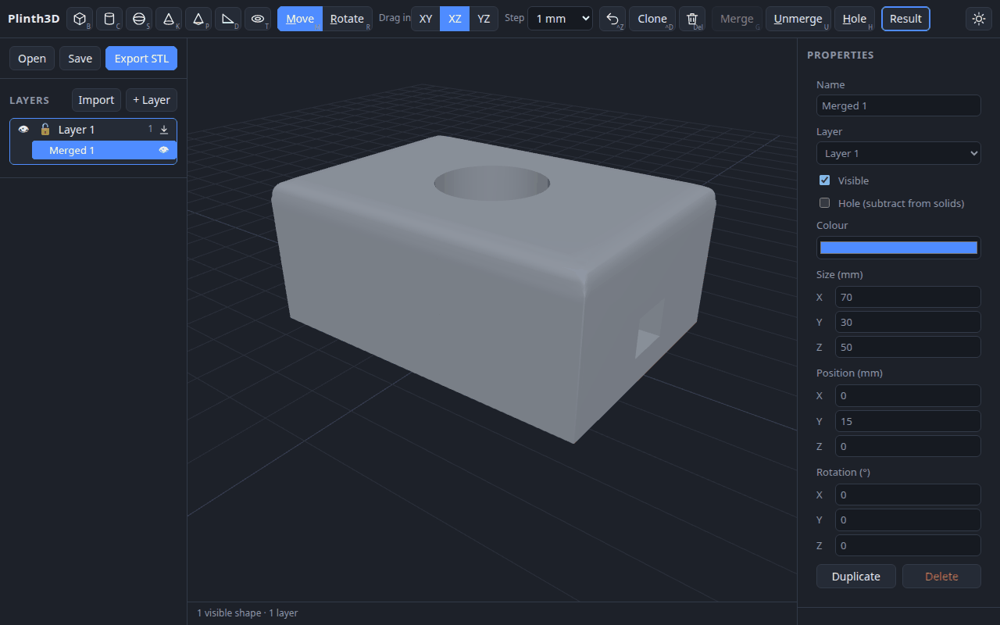
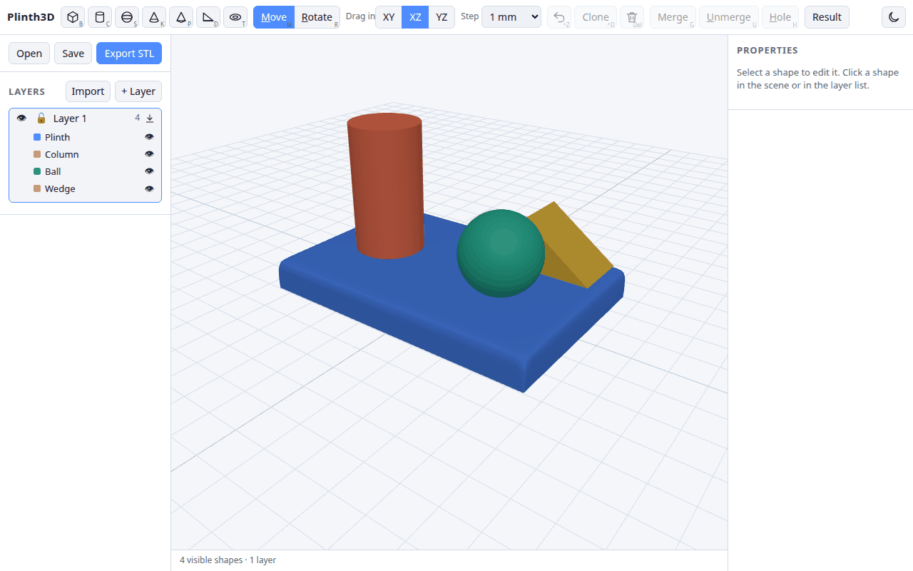

# Plinth3D

**A browser-based, Tinkercad-style 3D modeller for designing things to 3D print.**
Build with simple shapes, cut with holes, round the edges, and export an STL for your slicer.
Everything runs in your browser: there is no server and no account.

**[Try it live](https://apiel.github.io/plinth3d/)**



> **Status:** early MVP. Expect rough edges, and please report what you find.

## Why Plinth3D

- **Simple.** Add shapes with one click, move them with arrows, resize them by dragging a face, or type exact millimetres.
- **Made for printing.** Units are millimetres, exports are binary STL in Z-up for slicers, and holes are real cuts.
- **Layers, like Photoshop.** Show, hide, lock and rename layers. Export a layer and import it into another project.
- **Private.** Your projects stay in your browser and in `.json` files you save yourself.

## A quick tour

### Combine shapes, cut with holes

Mark a shape as a hole, select it together with a solid, and press **Merge** (`G`). The holes cut the solids and the result becomes one object that moves and resizes like a primitive. **Unmerge** (`U`) brings the original shapes back.



### Round or chamfer corners and edges

Select a box or cylinder and use **Corners and edges** in the properties panel: pick rounded or chamfered, then type a size for the vertical corners (boxes), the top edge and the bottom edge. Zero is square.

### Light and dark

Switch themes from the toolbar. Your choice is remembered.



## Features

**Shapes**
- Box, cylinder, sphere, cone, pyramid, wedge and torus. Click an icon in the toolbar to add one to the plan; it is selected straight away.
- Round or chamfer the vertical corners, top edge and bottom edge of a box or cylinder (see above).
- Merge shapes into one object, and unmerge them again.
- Holes: a shape marked as a hole is subtracted from the solids it is merged with.

**Moving and resizing**
- Move with the arrow gizmo, or drag a shape's body. The Drag in XY / XZ / YZ buttons choose the plane a body drag moves in. XZ (across the plan) is the default.
- Rotate with the rotate gizmo.
- Resize by dragging an edge of the dashed box around the selected shape. The edge changes one dimension at a time. Click the edge to switch between its two axes. The opposite face stays in place.
- Step selector in the toolbar (Off, 0.1 to 10 mm) snaps moves, resizes and the arrows.
- While moving or resizing, a readout card follows the cursor. Type into it for an exact value.
- Shift + drag on empty space draws a rectangle that adds the shapes inside it to the selection.
- Properties panel for exact size, position, rotation, colour, layer and hole flag.

**Layers and projects**
- Layers: show/hide, lock, rename, create and delete. Each shape belongs to one layer.
- Hide a shape with its eye button. Hidden shapes are left out of the scene, the result and the export.
- Rename a shape by double-clicking its name in the layer list.
- Export a layer with its ⤓ button, and import a layer file with the Import button. An imported layer is added as a new layer.
- Save and open projects as `.json` files. The project also autosaves in your browser.
- Undo (`Ctrl+Z`), clone (`Ctrl+D`), delete (`Del`), and clear the selection with `Esc`.

**Output**
- Result view: preview the combined model with holes cut.
- Export STL (binary, millimetres, Z-up for slicers).

## Getting started

Requires Node.js 20 or newer.

```bash
npm install
npm run dev      # start the editor at http://localhost:5173
npm test         # run unit tests
npm run build    # type-check and build to dist/
```

## Keyboard shortcuts

| Key | Action |
| --- | --- |
| B / C / S / K / P / D / T | Add a box / cylinder / sphere / cone / pyramid / wedge / torus to the plan |
| M / R | Move / rotate tool |
| G | Merge the selection (Ctrl+G also works) |
| U | Unmerge: bring back the shapes a merged object was made from |
| H | Hole: toggle the selection as a hole |
| Ctrl+A | Select all visible shapes |
| Ctrl+D | Clone |
| Ctrl+Z | Undo |
| Del | Delete |
| Esc | Clear the selection |

The shortcut letter is underlined in each label, and icon buttons show it in the corner.

## How it works

- The editor is React and three.js. The geometry (merging, holes, the STL result) uses the [Manifold](https://github.com/elalish/manifold) engine, compiled to WebAssembly.
- Rounded and chamfered shapes are the convex hull of a few outlines stacked at different heights (`edgedSolid` in [`src/geometry.ts`](src/geometry.ts)), which Manifold builds in milliseconds.

## Project file format

Projects are plain JSON, so they are easy to diff and version-control:

```json
{
  "format": "plinth3d",
  "version": 1,
  "layers": [{ "id": "...", "name": "Layer 1", "visible": true, "locked": false }],
  "shapes": [
    {
      "id": "...", "name": "Box 1", "type": "box", "layerId": "...",
      "position": [0, 10, 0], "rotation": [0, 0, 0], "size": [20, 20, 20],
      "color": "#4f8cff", "hole": false,
      "edges": { "style": "round", "vertical": 4, "top": 2, "bottom": 0 }
    }
  ]
}
```

Units are millimetres. Rotations are degrees, applied in XYZ order. The app's Y axis is up.

`edges` is optional and applies to boxes and cylinders. `style` is `round` or `chamfer`; the other three are sizes in mm (`vertical` is for boxes only).

## Roadmap

- Save and load projects to a GitHub repository, so each user can keep their designs in their own repo.
- More primitives and shape editing (for example, text).

## Licence

MIT. See [LICENSE](LICENSE).
